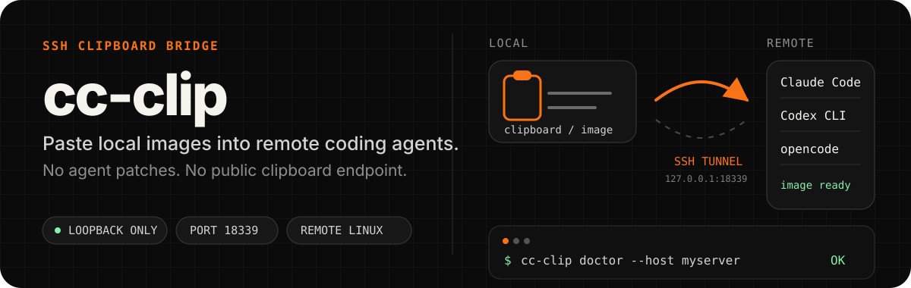
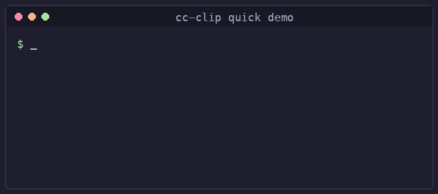

<!-- i18n-source: README.md @ 020ef8e6c161c5950ee0197c35fcf3a9e6f95ba3 -->

<p align="center">
  <a href="README.md">English</a> ·
  <a href="README.zh-CN.md">简体中文</a> ·
  <b>日本語</b>
</p>

<p align="center">
  
</p>

> これは英語版の日本語訳です。内容に差異がある場合は [English 原文](README.md) を正とします。この翻訳は英語版のメインラインより遅れている場合があります。

<p align="center">
  <a href="https://github.com/ShunmeiCho/cc-clip/releases"></a>
  <a href="https://github.com/ShunmeiCho/cc-clip/actions/workflows/ci.yml"></a>
  <a href="LICENSE"></a>
</p>

<p align="center">
  <b>SSH 経由のリモート Claude Code、Codex CLI、opencode、Cursor セッションに画像を貼り付け、さらにターミナルの折り返し改行なしでテキストをローカルへコピーバックできます。</b><br>
  オプションの統合により、完了通知と承認通知をデスクトップへ届けられます。
</p>

<p align="center">
  <a href="#クイックスタート">クイックスタート</a> ·
  <a href="#ターゲットを選ぶ">ターゲットを選ぶ</a> ·
  <a href="#できること">できること</a> ·
  <a href="#すべてのコマンド">すべてのコマンド</a> ·
  <a href="#仕組み">仕組み</a> ·
  <a href="#ドキュメント">ドキュメント</a>
</p>

<p align="center">
  
  <br>
  <em>インストール → セットアップ → SSH を開く → 貼り付け。</em>
</p>

> **v0.8.x からアップグレードしますか？** v0.9.0 では、`--codex` が Codex 専用になりました。同じホストで Claude 統合も必要な場合は
> `--all` を使用してください。詳しくは
> [アップグレードガイド](docs/upgrading.md#upgrading-from-v08x-to-v090)を参照してください。

## クイックスタート

これは安定版の macOS から Linux への経路です。以下が必要です。

- macOS 13 以降
- `curl`、`bash`、および `xclip` または `wl-paste` がある Linux リモート
- `~/.ssh/config` 内の名前付き `Host` エントリ

### 1. インストール

```bash
curl -fsSL https://raw.githubusercontent.com/ShunmeiCho/cc-clip/main/scripts/install.sh | sh
cc-clip --version
```

インストーラーから求められた場合は、続行する前に `~/.local/bin` を `PATH` に追加してください。

### 2. 1 台のホストをセットアップ

```bash
cc-clip setup myserver
```

デフォルトのターゲットは Claude Code です。セットアップでは、ローカル依存関係の確認、ループバック
`RemoteForward` の追加、ローカルデーモンの起動、リモート shim（互換レイヤー）のデプロイを行います。
Codex、opencode、通知には、次のセクションにあるターゲット flag を使用してください。

### 3. 新しい SSH セッションを開く

```bash
ssh myserver
```

coding agent を起動し、通常どおり貼り付けてください。新しい SSH 接続が重要です。
この接続がリバーストンネルを開いた状態に保ちます。

### 4. 経路全体を検証

画像を Mac のクリップボードへコピーし、ローカルで次を実行してください。

```bash
cc-clip doctor --host myserver
```

## ターゲットを選ぶ

セットアップごとに selector を 1 つ選んでください。selector がない場合、cc-clip は Claude Code を設定します。

| リモートワークフロー | セットアップコマンド | 画像貼り付け | デスクトップ通知 | 追加要件 |
|---|---|:---:|:---:|---|
| Claude Code | `cc-clip setup myserver` | はい | はい | `xclip` または `wl-paste` |
| Codex CLI のみ | `cc-clip setup myserver --codex` | はい | はい | Xvfb。セットアップにリモートの `sudo` が必要な場合があります |
| すべての統合 | `cc-clip setup myserver --all` | はい | はい | Codex には Xvfb |
| opencode | `cc-clip setup myserver --opencode` | はい | はい | `xclip` または `wl-paste` |
| Antigravity | `cc-clip setup myserver --agy` | いいえ | はい | 通知統合のみ |
| Cursor CLI | `cc-clip setup myserver --cursor` | はい | はい | Cursor を実行する shell に `DISPLAY` または `WAYLAND_DISPLAY` が設定されていること |

Codex ターゲットでは、cc-clip は `apt` または `dnf` を使って Xvfb のインストールを試みます。
passwordless `sudo` が使えない場合は停止し、正確なインストールコマンドを表示します。
そのコマンドを手動で実行してから、セットアップを繰り返してください。

Claude、opencode、Cursor の経路では、リモートの `xclip` または `wl-paste` shim を使用します。Codex は
X11 を直接読み取るため、そのターゲットでは代わりに Xvfb と `cc-clip x11-bridge` を追加します。

Cursor にはデプロイでは満たせない前提条件が 1 つあります。Cursor を実行する shell に
`DISPLAY` または `WAYLAND_DISPLAY` が設定されている場合のみ、Cursor はクリップボードを
読み取ります（`echo $DISPLAY` で確認）。`ssh -X myserver` で接続するか、既存のディスプレイを
エクスポートしてください。cc-clip が意図的に自前の値を注入しないのは、背後に X サーバーの
ない `DISPLAY` は、その shell のほかのすべてのツールのクリップボードフォールバックを
確実に壊してしまうからです。また Cursor は約 4 秒でクリップボードヘルパーの待機を
打ち切るため、遅いリンクで大きな画像を転送する場合はリモート shell の rc に
`export CC_CLIP_FETCH_TIMEOUT_MS=3000` を追加してください。Cursor の通知は
`~/.cursor/hooks.json` にマージされる stop hook から届きます。このファイル内の既存のフックはそのまま残ります。

リモートの `cc-clip` がすでにパッケージマネージャの管理下にある場合は、
`cc-clip setup myserver --use-remote-bin` でその所有権を保てます。セットアップはリモートの
**ログイン shell** の PATH で `cc-clip` を解決し（そのため `~/.nix-profile/bin` や pipx、
asdf のインストールも見つかります）、バージョンとハッシュを記録した上で、代替バイナリを
アップロードせずに通常の統合セットアップを行います。

このモードはホストのデプロイ状態に記録されます。以降の `cc-clip connect` 実行は——
`cc-clip update` が提示する `connect <host> --force` の行も含めて——フラグなしで
パッケージ管理バイナリを使い続けます。`--local-bin` でデプロイすると、ホストは
アップロード方式へ戻ります。同一実行内でこのフラグと `--local-bin` は併用できません。

> opencode と Antigravity の統合生成はテストでカバーされていますが、代表的なマシンでの
> ホストイベント配信はまだ smoke test されていません。
> 結果を [報告してください](https://github.com/ShunmeiCho/cc-clip/issues)。
>
> Kimi Code と MastraCode は shim がインターセプトする `wl-paste` / `xclip` 呼び出しで
> クリップボードを読み取るため、デフォルトのターゲットで画像の貼り付けが動作するはずです。
> これはソースに対する静的な確認と shim のテストで検証されていますが、実際の CLI での
> end-to-end の検証はまだです。
>
> Grok Build（xAI の `grok` CLI）は Codex と同じくプロセス内で X11 のクリップボードを直接
> 読み取るため、Codex のターゲットで貼り付けられます。`--codex`、Claude Code も残す場合は
> `--all` を使ってください。これはソースに対する静的な確認で検証されていますが、end-to-end の
> 検証はまだです。Grok Build はクリップボードの読み取りを約 2 秒で諦めるため、低速な回線で
> 大きな画像を送ると間に合わない場合があります。

### その他のローカルプラットフォーム

| ローカルマシン | リモート | サポートレベル | 推奨経路 |
|---|---|---|---|
| macOS 13+ | Linux | 安定版 | `cc-clip setup HOST` |
| Windows 10/11 | Linux | 実験的 | [`send` / `hotkey` クイックスタート](docs/windows-quickstart.md) |
| Linux | Linux | 手動デーモン | `cc-clip serve` を実行し、別の shell で `cc-clip setup HOST` を実行 |

Windows サポートは引き続き実験的です。まずは [Windows クイックスタート](docs/windows-quickstart.md)の
明示的なアップロードと貼り付けのワークフローを使用してください。任意で有効にする
直接 RemoteForward 転送もあります（v0.9.1 以降）が、これはデフォルトではありません。

## できること

以下の各機能について、何をするのか、なぜ使うのか、どう有効にするのか、動作しているときに何が見えるのかを説明します。`myserver` は自分のホスト名に置き換えてください。

### リモートの agent に画像を貼り付ける

- **内容:** リモートの Claude Code、opencode、Cursor、Kimi Code、MastraCode セッションで
  `Ctrl+V` を押すと、ローカルのクリップボードにある画像が貼り付けられます。
- **理由:** リモートの agent からは Mac のクリップボードが見えません。cc-clip がなければ、
  スクリーンショットを保存し、`scp` で転送し、そのパスを入力する必要があります。
- **使い方:** `cc-clip setup myserver` を実行し（opencode や Cursor では `--opencode` または
  `--cursor` を追加）、**新しい** `ssh myserver` を開いて通常どおり貼り付けてください。
- **結果:** agent はローカルと同じように画像を添付します。また Mac には画像のサイズと形式を
  示す `cc-clip #N` 通知が表示されるため、貼り付けの抜けや重複にすぐ気づけます。

### Codex CLI に画像を貼り付ける

- **内容:** Codex と Grok Build でも同じく `Ctrl+V` で貼り付けられます。
- **理由:** Codex と Grok Build は `xclip` を呼び出さず X11 のクリップボードを直接読み取るため、
  上記の shim では届きません。cc-clip はリモートで専用の仮想ディスプレイ（Xvfb）を動かし、そこから画像を渡します。
- **使い方:** `cc-clip setup myserver --codex`（Claude Code も残す場合は `--all`）を実行し、
  shell がディスプレイ設定を読み込むように新しい SSH セッションを開いてください。
- **結果:** agent が画像を添付します。添付されない場合は
  [トラブルシューティング](#トラブルシューティング)の Codex の項目を参照してください。

### リモートのテキストをローカルのクリップボードへコピーする

- **内容:** リモートでコピーしたテキストがローカルのクリップボードに入ります。
- **理由:** マウスでテキストを選択すると、ターミナルが描画した内容がコピーされるため、長い行は
  折り返しの改行で分断されて戻ってきます。リモート側でコピーすれば、バイト列がそのまま保たれます。
- **使い方:** リモートで任意の出力を `cc-clip copy` にパイプするか、neovim / tmux の copy-mode を
  `xclip` または `wl-copy` を使うように設定した上で yank してください
  （[それぞれの設定方法](docs/reverse-copy.md)）。

  ```bash
  git diff | cc-clip copy
  ```

- **結果:** テキストがローカルのクリップボードに入り、"Clipboard set by remote" という通知が
  表示されます。通知の本文にコピーした内容が含まれることはなく、連続した yank は 1 つの通知にまとめられます。
- **不要な場合:** テキストは双方向に流れます。リモートの token を持つプロセスは、ローカルのクリップボードの
  テキストを読むこともできます。画像の貼り付けしか使わない場合は、`cc-clip service install --text off` で
  テキストのブリッジを無効にできます（この方向だけ残すなら `--text write`）。詳しくは [SECURITY.md](SECURITY.md) を参照してください。

### agent が操作を待っているときにデスクトップ通知を受け取る

- **内容:** リモートの agent がターンを終えたときや、ツールの承認を待っているときに Mac へ通知します。
- **理由:** ターミナルを見張る代わりに、別のウィンドウで作業できます。リモートの通知は通常 SSH を越えて届きません。
- **使い方:** 追加の作業は不要です。`setup` / `connect` が、選択したすべてのターゲットの通知フックを設定します
  （[CLI ごとの詳細](docs/notifications.md)）。
- **結果:** たとえば Claude Code 自身の承認メッセージを含む "Tool approval needed" 通知が表示されます。
  ホストからの通知が実際に届いているかを確認するには、`cc-clip doctor --host myserver` を実行し、
  下記の `delivery-receipt` の行を確認してください。

### すべてが動作するか確認する

- **内容:** `cc-clip doctor --host myserver` は、クリップボードからリモートの agent までの
  すべての経路をテストし、各チェックを理由とともに `[pass]` または `[FAIL]` で報告します。
- **理由:** 貼り付けは複数の箇所（デーモン、SSH forward、token、shim、PATH）で失敗する可能性があり、
  箇所ごとに対処方法が異なります。
- **使い方:** ローカルで画像をコピーしてから、上記のコマンドをローカルマシンで実行してください。
- **結果:** チェックごとに 1 行が表示されます。最初の `[FAIL]` を修正してください。以降の失敗は
  たいていそこから派生しています。通知の行が実行を失敗させることはなく、このホストから各 CLI が
  最後に通知を届けた時刻を示します。

  ```text
    delivery-receipt:claude: [pass] last notification accepted 2h13m ago
    delivery-receipt: [pass] never received from: cursor, opencode, agy (fine for any you do not use on this host)
  ```

### 自分の `xclip` や `wl-paste` を残す

- **内容:** cc-clip は、`~/.local/bin/xclip`、`wl-paste`、`wl-copy` にある自分が書いていない
  通常ファイルを上書きしません。（そこにある symlink は置き換えられますが、リンク先のプログラムは
  そのまま残り、shim のフォールバック先になります。）
- **理由:** そのファイルは自作のラッパーやビルドかもしれません。黙って失われると、ほかのツールが壊れます。
- **使い方:** `connect` が `... already exists and was not written by cc-clip` で停止した場合は、
  自分でファイルを移動するか、cc-clip に退避させてください。

  ```bash
  cc-clip connect myserver --adopt-foreign-shim
  ```

- **結果:** プログラムは `~/.local/bin/xclip.cc-clip-real` へ移動されます。shim は自分で処理しない
  呼び出しをすべてそのプログラムに渡し、リモートで `cc-clip uninstall` を実行すると元の場所へ戻ります。

### すべてのホストを最新に保つ

- **内容:** `cc-clip hosts list` は、このマシンがデプロイしたホストを、cc-clip のバージョンと
  最後に確認された時刻とともに表示します。
- **理由:** ローカル側とリモート側は別々にアップグレードされます。古いバージョンのまま残った
  ホストは、古い shim とフックを使い続けます。
- **使い方:** ローカルをアップグレードしてから、各ホストを再デプロイしてください。

  ```bash
  cc-clip update
  cc-clip connect myserver --force
  ```

- **結果:** `cc-clip hosts list` がそのホストの新しいバージョンを表示します。

### トンネルを単独で維持する (実験的)

- **内容:** `cc-clip tunnel run myserver` はホストへの専用 SSH 接続を維持し、その接続で
  貼り付け用のトンネルを保持します。デーモン経由でトンネルを確認し、切断されるとバックオフ
  しながら再接続します。
- **理由:** 通常は、最初に接続した `ssh myserver` がトンネルを持ちます。そのセッションを閉じた
  り、不安定な回線でクライアントが消えてもリモート側がポートを保持し続けたりすると、その
  セッションを見つけて終了するまで貼り付けが使えなくなります
  （[トラブルシューティング](docs/troubleshooting.md#stale-sshd-process-blocks-remoteforward)を参照してください）。
- **使い方:** ローカルマシン（`cc-clip serve` を動かしているマシン。リモートではありません）で、
  ホストごとに一度デプロイし、あとはターミナルで動かしたままにしてください。

  ```bash
  cc-clip connect myserver --force   # supervisor が確認するヘルパーをデプロイ
  cc-clip tunnel run myserver        # フォアグラウンドで実行。Ctrl-C で停止
  ```

- **結果:** `managed tunnel state: healthy` のようなタイムスタンプ付きの行が表示され、再接続や
  待機のたびに新しい状態が出力されます。誤ってリモートで実行すると、`identity-mismatch` で停止し
  理由を表示します。SSH の設定は変更しないため、すべての `ssh myserver` が同じポートを要求します。
  ほかのツールが保持しているバックグラウンド接続も同様です。先にポートを取った接続が保持し、
  supervisor は `port-conflict` を報告して待機します。試している間 supervisor にポートを持たせる
  には、`~/.ssh/config` の `Host myserver` にある `RemoteForward` の行をコメントアウトし、終わったら
  元に戻してください。`--use-remote-bin` で設定したホストはまだサポートしていません。また、
  supervisor の実行中は token が期限切れになりません。

### ホストから cc-clip を削除する

- **内容:** `setup` / `connect` がインストールしたものを元に戻します。
- **理由:** ホストで cc-clip の使用をやめるため、またはクリーンな状態からやり直すためです。
- **使い方:** shim はリモートにあるため、削除は 2 か所で行います。先にリモート側の手順を
  実行してください。ローカル側の手順は、リモートの shell が `cc-clip` を見つけるための PATH
  エントリを削除するためです。

  ```bash
  # 1. リモートホストで: shim を削除し、退避したプログラムがあれば元に戻す。
  #    Wayland のホストでは --target wl-paste が必要です（wl-copy も対象になります）。
  cc-clip uninstall

  # 2. ローカルマシンで: 管理対象の Claude フックと PATH marker を削除する
  cc-clip uninstall --host myserver
  #    Codex を使っていた場合は、そのディスプレイとブリッジも削除する
  cc-clip uninstall --codex --host myserver
  ```

- **結果:** リモートに `Shim removed successfully.` と表示されます。その間に別のプロセスが shim や
  プログラムを変更していた場合、uninstall は何も削除せずに停止し、何をどこに残したかを表示します。
  パスが落ち着いたら再実行してください。Mac では、手順 2 で削除するローカルの shim がないという
  警告も表示されますが、これは想定どおりです。

## 仕組み

cc-clip は transport を狭く保ち、SSH 接続内に限定します。

```text
Image paste
  local clipboard
      → cc-clip daemon on 127.0.0.1:18339
      → SSH RemoteForward
      → remote xclip/wl-paste shim or Xvfb bridge
      → remote coding agent

Notifications
  remote hook / notify command / plugin
      → SSH tunnel
      → local cc-clip daemon
      → macOS Notification Center or cmux
```

1. ローカルデーモンは、リモート側から要求されたときだけクリップボードデータを読み取ります。
2. SSH はそのデーモンをリモートのループバックで公開します。public listener は作成されません。
3. Claude Code と opencode は、透過的なクリップボード shim を経由してアクセスします。
4. Codex は `xclip` を呼び出さず X11 を直接読み取るため、Xvfb のクリップボード owner を経由してアクセスします。
5. 認識されない `xclip` / `wl-paste` 呼び出しは、リモートの実体ツールへそのまま渡されます。

## 通知

クリップボードデータと agent event は SSH トンネルを共有しますが、別々の認証情報を使用します。
`cc-clip connect` は次を接続できます。

| ソース | 統合 | イベント例 |
|---|---|---|
| Claude Code | 管理対象フック | 停止、承認リクエスト、画像貼り付け |
| Codex CLI | `notify` コマンド | タスク完了 |
| opencode | 生成された plugin | セッション idle |
| Antigravity | 生成された plugin | agent 停止 |
| Cursor CLI | `~/.cursor/hooks.json` の stop hook | ターン終了 |

adapter の詳細、手動設定、nonce 登録、診断については、
[SSH 通知](docs/notifications.md)を参照してください。

## セキュリティモデル

| 境界 | 保護 |
|---|---|
| ネットワーク | デーモンと転送ポートはループバックのみに bind |
| クリップボード | 30 日間の sliding expiration を持つ Bearer token |
| 通知 | 接続ごとに別の nonce |
| プロセス一覧 | token と hook payload をコマンドライン引数に置きません |
| fallback | 無関係なクリップボード呼び出しは、リモートの実体 binary へそのまま渡されます |

ループバックは、同じリモートホスト上のユーザー間で共有されます。token file の mode は
`0600` ですが、cc-clip は同じ Unix account として動作する別プロセスや、ファイルを読み取る
別プロセスからの防御は行いません。共有または信頼できないホストで cc-clip を使用する前に、
明示的な [threat model](SECURITY.md) を確認してください。

## すべてのコマンド

`cc-clip` のすべてのコマンドを、実行するマシンごとにまとめています。すべての flag は
[コマンドリファレンス](docs/commands.md)に記載されています。

**ローカルマシンで: ホストのセットアップと保守**

| コマンド | 内容と使うタイミング |
|---|---|
| `cc-clip setup HOST [target]` | 1 台のホストの初回セットアップです。ローカル依存関係の確認、SSH の `RemoteForward` の追加、デーモンの起動、デプロイを行います。まずここから始めてください。 |
| `cc-clip connect HOST [target]` | セットアップ済みのホストに cc-clip をデプロイ（または再デプロイ）します。変更された部分だけが再送されます。 |
| `cc-clip connect HOST --force` | ホストが報告する状態を無視して完全に再デプロイします。`cc-clip update` の後や、ホストが壊れたときに使用してください。 |
| `cc-clip connect HOST --token-only` | 現在の token だけを送ります。デーモンの再起動後に token エラーで貼り付けが止まったときに使用してください。 |
| `cc-clip connect HOST --adopt-foreign-shim` | 自分が書いていない `xclip` / `wl-paste` / `wl-copy` を、停止する代わりに退避させてデプロイします。[自分の `xclip` を残す](#自分の-xclip-や-wl-paste-を残す)を参照してください。 |
| `cc-clip hosts list` | このマシンがデプロイしたすべてのホストを、バージョン、Codex の状態、最終確認時刻とともに表示します。アップデート後に再デプロイが必要なホストを探すときに使用してください。 |
| `cc-clip hosts forget HOST` | その一覧からホストを削除します。リモートには触れません。 |
| `cc-clip uninstall --host HOST` | ホストから管理対象の Claude フックと PATH marker を削除します。先にホスト上で `cc-clip uninstall` を実行してください。[cc-clip の削除](#ホストから-cc-clip-を削除する)を参照してください。 |
| `cc-clip uninstall --codex --host HOST` | ホストから Codex サポートを削除します。ブリッジと Xvfb を停止し、Codex の `notify` エントリとディスプレイ設定を取り除きます。 |
| `cc-clip tunnel run HOST` | **実験的。**最初にポートを取った `ssh` セッションに頼らず、専用の SSH 接続でホストの貼り付け用トンネルを保持し、再接続します。リモートではなく、このマシンで実行してください。Ctrl-C までフォアグラウンドで動きます。先に一度 `connect HOST --force` を実行してください。`--reset` で作動したクラッシュループ保護を解除します。[トンネルを単独で維持する](#トンネルを単独で維持する-実験的)を参照してください。 |

**ローカルマシンで: デーモンと自分のインストール**

| コマンド | 内容と使うタイミング |
|---|---|
| `cc-clip serve` | クリップボードデーモンをフォアグラウンドで実行します。ローカルマシンが Linux の場合に必要です。macOS と Windows では下記のサービスを使用します。`--rotate-token` で新しい token を強制的に生成します。 |
| `cc-clip service install` / `uninstall` / `status` | ログイン時にデーモンを起動する設定（macOS launchd、Windows のログオン）を行う、削除する、または状態を表示します。`setup` が自動でインストールします。 |
| `cc-clip status` | デーモンが動作しているか、どのポートを使っているか、token が存在するかを表示します。ローカルの簡単な確認です。 |
| `cc-clip doctor` | ローカル側だけを確認します。 |
| `cc-clip doctor --host HOST` | ホストまでの経路全体を確認し、通知が最後に届いた時刻を表示します。貼り付けが失敗したときに最初に実行してください。 |
| `cc-clip update` | このマシンに最新のリリースをインストールします（macOS / Linux）。`--check` は報告のみ、`--to vX.Y.Z` はバージョンを指定します。その後、各ホストで `connect HOST --force` を実行してください。 |
| `cc-clip version` / `help` | バージョン、または組み込みのコマンド一覧を表示します。 |

**Windows で（実験的）**

| コマンド | 内容と使うタイミング |
|---|---|
| `cc-clip send [HOST] [FILE]` | クリップボードの画像、またはファイルをホストへアップロードし、リモートのパスを表示します。`--paste` を付けると、そのパスをアクティブなウィンドウに入力します。 |
| `cc-clip hotkey [HOST]` | 1 回のキー操作で `send --paste` を実行するグローバルホットキー（デフォルトは `Alt+Shift+V`）を動かします。`--enable-autostart`、`--status`、`--stop` で管理します。[Windows クイックスタート](docs/windows-quickstart.md)を参照してください。 |

**リモートホストで**

| コマンド | 内容と使うタイミング |
|---|---|
| `some-command \| cc-clip copy` | パイプされたテキストをバイト単位でそのまま**ローカル**のクリップボードに入れます。1 行を超える内容は、マウス選択の代わりにこれを使用してください。 |
| `cc-clip uninstall` | このホストのクリップボード shim を削除し、`--adopt-foreign-shim` で退避したプログラムを元に戻します。Wayland のホストでは `--target wl-paste` を追加してください。 |
| `cc-clip notify --title T --body B` | 長いスクリプトの終了時などに、自分の通知をローカルのデスクトップへ送ります。`--trusted` を付けない場合、タイトルの先頭に `[unverified]` が付きます。 |
| `cc-clip paste` | ローカルのクリップボードの画像をリモートのファイルに保存し、そのパスを表示します。貼り付けではなく画像のパスを受け取るスクリプトやツール向けです。 |

**cc-clip 自身が使用するもの**（実行する必要はありません）

| コマンド | 用途 |
|---|---|
| `cc-clip install` | shim をインストールします。`connect` がリモートで実行します。 |
| `cc-clip plugin run NAME` | 各 agent が呼び出す通知フックです（`claude-notify`、`codex-notify`、`opencode-notify`、`agy-notify`、`cursor-notify`）。 |
| `cc-clip x11-bridge` | Xvfb 経由で Codex にクリップボードを渡します。`connect --codex` が起動します。 |
| `cc-clip tunnel probe-identity` | リモートでマネージドトンネルの identity チェックに応答します。`tunnel run` が呼び出します。 |

### 設定

| 設定 | デフォルト | environment variable |
|---|---:|---|
| トンネルポート | `18339` | `CC_CLIP_PORT` |
| token の有効期間 | `30d` | `CC_CLIP_TOKEN_TTL` |
| debug logging | オフ | `CC_CLIP_DEBUG=1` |

## トラブルシューティング

まず組み込み診断を実行してください。

```bash
cc-clip doctor --host myserver
```

最も一般的な 3 つの修正方法は次のとおりです。

- **トンネルを利用できない:** 新しい `ssh myserver` セッションを開いたままにしてください。
  `RemoteForward` は、SSH 接続が所有している間だけ存在します。
- **デーモン再起動後に token が拒否される:**
  `cc-clip connect myserver --token-only` を実行してください。
- **Codex にクリップボードがない:** 注入された `DISPLAY` を読み込むため、新しい SSH セッションを開いてください。
  Xvfb または x11-bridge がない場合は、
  `cc-clip connect myserver --codex --force`（または `--all --force`）を実行してください。

新しい SSH tab に `remote port forwarding failed for listen port 18339` と表示される場合、
別の live または stale SSH セッションが固定 remote port をすでに所有しています。
動作しているセッションを使用するか、古いセッションを閉じるか、
[トラブルシューティングガイド](docs/troubleshooting.md)の port cleanup 手順に従ってください。

## cc-clip を使わない方がよい場合

適している場合は、より単純な選択肢を使用してください。

- ワークフロー全体が editor 内にある場合は、editor 組み込みのリモートクリップボードを使用します。
- text-only のクリップボード同期には OSC 52 を使用します。
- 画像転送の頻度が低く、貼り付け動作を維持するためにデーモンと SSH forward を使う価値がない場合は、`scp` を使用します。
- 限定的な agent workflow ではなく、広範で双方向のクリップボード同期が必要な場合は、汎用クリップボードブリッジを使用します。
- リモートのローカルユーザーがユーザースコープのループバックトンネルにアクセスしてはならない、信頼できない共有ホストでは cc-clip を使用しないでください。

## ドキュメント

| ガイド | 内容 |
|---|---|
| [Windows クイックスタート](docs/windows-quickstart.md) | Windows の upload、paste、ホットキーワークフロー |
| [アップグレード](docs/upgrading.md) | breaking change と version-specific migration |
| [コマンド](docs/commands.md) | 一般的な command、flag、environment variable |
| [通知](docs/notifications.md) | hook と plugin の統合 |
| [トラブルシューティング](docs/troubleshooting.md) | symptom ごとの診断 |
| [セキュリティ](SECURITY.md) | threat model と trust boundary |

## コントリビュート

bug report と焦点を絞った pull request を歓迎します。大きな機能については、最初に
[issue](https://github.com/ShunmeiCho/cc-clip/issues)を開き、進め方を議論してください。

source から build するには、`go.mod` に宣言された Go version が必要です。

```bash
git clone https://github.com/ShunmeiCho/cc-clip.git
cd cc-clip
make build
make test
```

commit message には [Conventional Commits](https://www.conventionalcommits.org/) を使用してください
（`feat:`、`fix:`、`docs:` など）。

## ライセンス

[MIT](LICENSE)
