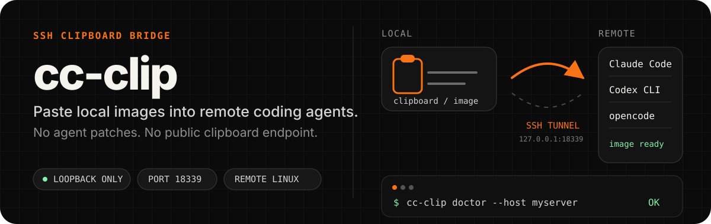
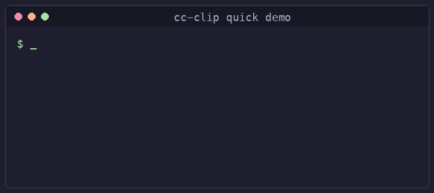

<p align="center">
  <b>English</b> ·
  <a href="README.zh-CN.md">简体中文</a> ·
  <a href="README.ja.md">日本語</a>
</p>

<p align="center">
  
</p>

<p align="center">
  <a href="https://github.com/ShunmeiCho/cc-clip/releases"></a>
  <a href="https://github.com/ShunmeiCho/cc-clip/actions/workflows/ci.yml"></a>
  <a href="LICENSE"></a>
</p>

<p align="center">
  <b>Paste images into remote Claude Code, Codex CLI, opencode, and Cursor sessions over SSH — and copy text back out, free of terminal soft-wrap.</b><br>
  Optional integrations bring completion and approval notifications back to your desktop.
</p>

<p align="center">
  <a href="#quick-start">Quick start</a> ·
  <a href="#choose-a-target">Choose a target</a> ·
  <a href="#what-you-can-do">What you can do</a> ·
  <a href="#all-commands">All commands</a> ·
  <a href="#how-it-works">How it works</a> ·
  <a href="#documentation">Documentation</a>
</p>

<p align="center">
  
  <br>
  <em>Install → setup → open SSH → paste.</em>
</p>

> **Upgrading from v0.8.x?** In v0.9.0, `--codex` became Codex-only. Use
> `--all` when the same host also needs the Claude integration. See the
> [upgrade guide](docs/upgrading.md#upgrading-from-v08x-to-v090).

## Quick Start

This is the stable macOS-to-Linux path. You need:

- macOS 13 or later;
- a Linux remote (amd64 or arm64) with `curl`, `bash`, and `xclip` or `wl-paste`;
- a named `Host` entry in `~/.ssh/config`.

### 1. Install

```bash
curl -fsSL https://raw.githubusercontent.com/ShunmeiCho/cc-clip/main/scripts/install.sh | sh
cc-clip --version
```

If the installer asks, add `~/.local/bin` to your `PATH` before continuing.

### 2. Set up one host

```bash
cc-clip setup myserver
```

The default target is Claude Code. Setup checks local dependencies, adds the
loopback `RemoteForward`, starts the local daemon, and deploys the remote shim.
Use a target flag from the next section for Codex, opencode, or notifications.

### 3. Open a new SSH session

```bash
ssh myserver
```

Start your coding agent and paste as usual. The new SSH connection is important:
it is what holds the reverse tunnel open.

### 4. Verify the whole path

Copy an image to the Mac clipboard, then run locally:

```bash
cc-clip doctor --host myserver
```

## Choose a Target

Choose one selector per setup. With no selector, cc-clip configures Claude Code.

| Remote workflow | Setup command | Image paste | Desktop notifications | Extra requirement |
|---|---|:---:|:---:|---|
| Claude Code | `cc-clip setup myserver` | Yes | Yes | `xclip` or `wl-paste` |
| Codex CLI only | `cc-clip setup myserver --codex` | Yes | Yes | Xvfb; setup may need remote `sudo` |
| All integrations | `cc-clip setup myserver --all` | Yes | Yes | Xvfb for Codex |
| opencode | `cc-clip setup myserver --opencode` | Yes | Yes | `xclip` or `wl-paste` |
| Antigravity | `cc-clip setup myserver --agy` | No | Yes | Notification integration only |
| Cursor CLI | `cc-clip setup myserver --cursor` | Yes | Yes | `DISPLAY` or `WAYLAND_DISPLAY` set in Cursor's shell |

For Codex targets, cc-clip tries to install Xvfb with `apt` or `dnf`. If
passwordless `sudo` is unavailable, it stops and prints the exact install command;
run that command manually, then repeat setup.

The Claude, opencode, and Cursor paths use the remote `xclip` or `wl-paste`
shim. Codex reads X11 directly, so its target adds Xvfb and `cc-clip x11-bridge`
instead.

Cursor has one extra prerequisite the deploy cannot satisfy: its clipboard
reader only runs when `DISPLAY` or `WAYLAND_DISPLAY` is set in the shell where
Cursor runs (check with `echo $DISPLAY`). Connect with `ssh -X myserver` or
export an existing display — cc-clip deliberately does not invent one, because
a `DISPLAY` with no X server behind it would break clipboard fallback for every
other tool in that shell. Cursor also stops waiting for clipboard helpers after
about 4 seconds, so for large images over a slow link add
`export CC_CLIP_FETCH_TIMEOUT_MS=3000` to your remote shell rc. Cursor
notifications come from a stop hook merged into `~/.cursor/hooks.json`; your
own hooks in that file are kept.

If a package manager already owns `cc-clip` on the remote, preserve that
ownership with `cc-clip setup myserver --use-remote-bin`. Setup resolves
`cc-clip` under your remote **login shell's** PATH (so `~/.nix-profile/bin`,
pipx and asdf installs are found), records its version and hash, and performs
the normal integration setup without uploading a replacement binary.

The mode is remembered in the host's deploy state: later `cc-clip connect`
runs — including the `connect <host> --force` line that `cc-clip update`
suggests — keep using the package-managed binary without needing the flag
again. Deploy with `--local-bin` to switch the host back to uploaded
binaries. The flag cannot be combined with `--local-bin` in the same run.

> opencode and Antigravity integration generation is covered by tests, but host
> event delivery has not yet been smoke-tested on a representative machine.
> Please [report what you find](https://github.com/ShunmeiCho/cc-clip/issues).
>
> Kimi Code and MastraCode read the clipboard through `wl-paste` / `xclip`
> invocations the shim intercepts, so image paste should work with the default
> target. This is verified statically against their source and by shim tests,
> not yet end to end with the real CLIs.
>
> Grok Build (xAI's `grok` CLI) reads the X11 clipboard in-process, the same way
> Codex does, so it pastes through the Codex target: `--codex`, or `--all` to keep
> Claude Code as well. This is verified statically against its source, not yet end
> to end. Grok Build gives up on a clipboard read after about 2 seconds, so a large
> image over a slow link may not arrive in time.

### Other local platforms

| Local machine | Remote | Support level | Recommended path |
|---|---|---|---|
| macOS 13+ | Linux | Stable | `cc-clip setup HOST` |
| Windows 10/11 | Linux | Experimental | [`send` / `hotkey` quick start](docs/windows-quickstart.md) |
| Linux | Linux | Manual daemon | Run `cc-clip serve`, then `cc-clip setup HOST` in another shell |

Windows support remains experimental. Start with the explicit upload-and-paste
workflow in the [Windows Quick Start](docs/windows-quickstart.md). An opt-in
direct RemoteForward transport also exists (since v0.9.1), but it is not the
default.

## What You Can Do

Each feature below says what it does, why you would use it, how to turn it on,
and what you should see when it works. Replace `myserver` with your host.

### Paste an image into a remote agent

- **What:** `Ctrl+V` in a remote Claude Code, opencode, Cursor, Kimi Code or
  MastraCode session pastes the image on your local clipboard.
- **Why:** the remote agent cannot see your Mac's clipboard. Without cc-clip
  you would save the screenshot, `scp` it over, and type its path.
- **How:** `cc-clip setup myserver` (add `--opencode` or `--cursor` for those
  agents), then open a **new** `ssh myserver` and paste as usual.
- **You'll see:** the agent attaches the image as it does locally, and your Mac
  shows a `cc-clip #N` notification with the image's size and format, so a
  missing or duplicated paste is easy to spot.

### Paste an image into Codex CLI

- **What:** the same `Ctrl+V`, for Codex and Grok Build.
- **Why:** Codex and Grok Build read the X11 clipboard directly instead of calling
  `xclip`, so the shim above cannot reach them. cc-clip runs a private virtual display
  (Xvfb) on the remote and serves your image from it.
- **How:** `cc-clip setup myserver --codex` (or `--all` to keep Claude Code as
  well), then open a new SSH session so the shell picks up the display setting.
- **You'll see:** the agent attaches the image. If it does not, see the Codex
  entry in [Troubleshooting](#troubleshooting).

### Copy text from the remote to your local clipboard

- **What:** text copied on the remote lands on your local clipboard.
- **Why:** selecting text with the mouse copies what the terminal drew, so long
  lines come back broken by soft-wrap newlines. Copying on the remote side
  keeps the bytes exact.
- **How:** pipe anything into `cc-clip copy` on the remote, or yank in
  neovim / tmux copy-mode once they are set to use `xclip` or `wl-copy`
  ([setup for each](docs/reverse-copy.md)):

  ```bash
  git diff | cc-clip copy
  ```

- **You'll see:** the text in your local clipboard, and a notification
  "Clipboard set by remote". Its text never includes what was copied, and a
  burst of yanks shows up as one notification.
- **Don't need it?** Text goes both ways: a process holding the remote token
  can also read your local clipboard text. The daemon serves only the features
  you list: `cc-clip service install --features image` keeps image paste and
  turns everything else off, and `--features image,text-write` keeps just this
  direction. See [SECURITY.md](SECURITY.md).

### Get a desktop notification when the agent needs you

- **What:** your Mac notifies you when a remote agent finishes its turn or
  waits for a tool approval.
- **Why:** you can work in another window instead of watching the terminal.
  Remote notifications do not normally cross SSH.
- **How:** nothing extra: `setup` / `connect` wire the notification hook for
  every target you selected ([details per CLI](docs/notifications.md)).
- **You'll see:** for example a "Tool approval needed" notification carrying
  Claude Code's own permission message. To confirm that notifications from a host actually arrive, run
  `cc-clip doctor --host myserver` and read the `delivery-receipt` lines below.

### Check that everything works

- **What:** `cc-clip doctor --host myserver` tests every link from your
  clipboard to the remote agent, and reports each check as `[pass]` or
  `[FAIL]` with the reason.
- **Why:** paste can fail at several points (daemon, SSH forward, token, shim,
  PATH), and the fix differs for each.
- **How:** copy an image locally, then run the command above on your local
  machine.
- **You'll see:** one line per check. Fix the first `[FAIL]`, the later ones
  usually follow from it. The notification lines never fail the run; they tell
  you when each CLI last delivered a notification from this host:

  ```text
    delivery-receipt:claude: [pass] last notification accepted 2h13m ago
    delivery-receipt: [pass] never received from: cursor, opencode, agy (fine for any you do not use on this host)
  ```

### Keep your own `xclip` or `wl-paste`

- **What:** cc-clip never overwrites a regular file at `~/.local/bin/xclip`,
  `wl-paste` or `wl-copy` that it did not write. (A symlink there is replaced,
  but the program it points to is left alone and becomes the shim's fallback.)
- **Why:** that file may be your own wrapper or build; losing it silently would
  break other tools.
- **How:** if `connect` stops with `... already exists and was not written by
  cc-clip`, either move the file away yourself, or let cc-clip set it aside:

  ```bash
  cc-clip connect myserver --adopt-foreign-shim
  ```

- **You'll see:** your program moved to `~/.local/bin/xclip.cc-clip-real`. The
  shim hands every call it does not handle to that program, and `cc-clip
  uninstall` on the remote moves it back.

### Keep every host up to date

- **What:** `cc-clip hosts list` shows each host this machine has deployed to,
  with its cc-clip version and when it was last seen.
- **Why:** the local and remote sides are upgraded separately; a host left on an
  old version keeps the old shim and hooks.
- **How:** upgrade locally, then redeploy each host:

  ```bash
  cc-clip update
  cc-clip connect myserver --force
  ```

- **You'll see:** `cc-clip hosts list` reports the new version for that host.

### Keep the tunnel up on its own (experimental)

- **What:** `cc-clip tunnel run myserver` keeps a private SSH connection to the
  host that holds the paste tunnel, checks it through the daemon, and reconnects
  with backoff when it drops.
- **Why:** normally whichever `ssh myserver` connects first owns the tunnel. When
  that session closes, or its client disappears on a flaky network while the
  remote side keeps the port, paste stops working until you find and end it
  (see [Troubleshooting](docs/troubleshooting.md#stale-sshd-process-blocks-remoteforward)).
- **How:** on your local machine (the one running `cc-clip serve`, not the
  remote), deploy once per host, then leave it running in a terminal:

  ```bash
  cc-clip connect myserver --force   # deploys the helper the supervisor probes
  cc-clip tunnel run myserver        # foreground; Ctrl-C stops it
  ```

- **You'll see:** timestamped lines such as `managed tunnel state: healthy`, and
  a new state line whenever it reconnects or waits. Run on the remote by
  mistake, it stops with `identity-mismatch` and says so. Your SSH config is
  not changed, so every `ssh myserver` still asks for the same port, including
  background connections other tools keep open. Whichever got there first holds
  it, and the supervisor reports `port-conflict` and waits. To let the
  supervisor own the port while you try it, comment out the `RemoteForward`
  line under `Host myserver` in `~/.ssh/config`, and restore it afterwards.
  Hosts set up with `--use-remote-bin` are not supported yet, and while the
  supervisor runs it keeps the token from expiring.

### Remove cc-clip from a host

- **What:** undo what `setup` / `connect` installed.
- **Why:** to stop using cc-clip on a host, or to start from a clean state.
- **How:** removal happens in two places, because the shim lives on the
  remote. Do the remote step first: the local step removes the PATH entry that
  lets the remote shell find `cc-clip`.

  ```bash
  # 1. On the remote host: remove the shim and restore any adopted program.
  #    A Wayland host needs --target wl-paste (this also covers wl-copy).
  cc-clip uninstall

  # 2. On your local machine: remove the managed Claude hooks and the PATH marker
  cc-clip uninstall --host myserver
  #    and, if you used Codex, its display and bridge
  cc-clip uninstall --codex --host myserver
  ```

- **You'll see:** `Shim removed successfully.` on the remote. If another
  process changed the shim or your program meanwhile, uninstall stops without
  deleting anything and prints what it left where; run it again once the paths
  are settled. On a Mac, step 2 also warns that there is no local shim to
  remove; that is expected.

## How It Works

cc-clip keeps the transport narrow and local to your SSH connection:

```text
Image paste
  local clipboard
      → cc-clip daemon on 127.0.0.1:18339
      → SSH RemoteForward
      → remote xclip/wl-paste shim or Xvfb bridge
      → remote coding agent

Notifications
  remote hook / notify command / plugin
      → SSH tunnel
      → local cc-clip daemon
      → macOS Notification Center or cmux
```

1. The local daemon reads clipboard data only when the remote side asks for it.
2. SSH exposes that daemon on remote loopback; no public listener is created.
3. Claude Code and opencode reach it through a transparent clipboard shim.
4. Codex reaches it through an Xvfb clipboard owner because Codex reads X11
   directly instead of invoking `xclip`.
5. Unrecognized `xclip` / `wl-paste` calls fall through to the real remote tool.

## Notifications

Clipboard data and agent events share the SSH tunnel but use separate
authentication material. `cc-clip connect` can wire:

| Source | Integration | Example event |
|---|---|---|
| Claude Code | Managed hooks | Stop, approval request, image paste |
| Codex CLI | `notify` command | Task completion |
| opencode | Generated plugin | Session idle |
| Antigravity | Generated plugin | Agent stop |
| Cursor CLI | Stop hook in `~/.cursor/hooks.json` | Turn finished |

For adapter details, manual configuration, nonce registration, and diagnostics,
see [SSH Notifications](docs/notifications.md).

## Security Model

| Boundary | Protection |
|---|---|
| Network | Daemon and forwarded port bind to loopback only |
| Clipboard | Bearer token with 30-day sliding expiration |
| Notifications | Separate per-connect nonce |
| Process list | Tokens and hook payloads are not placed in command-line arguments |
| Fallback | Unrelated clipboard calls pass through to the real remote binary |

Loopback is shared by users on the same remote host. The token file is mode
`0600`, but cc-clip does not defend against another process acting as your Unix
account or reading your files. Read the explicit [threat model](SECURITY.md)
before using cc-clip on a shared or untrusted host.

## All Commands

Every `cc-clip` command, grouped by the machine you run it on. The
[commands reference](docs/commands.md) lists every flag.

**On your local machine: set up and maintain hosts**

| Command | What it does, and when to use it |
|---|---|
| `cc-clip setup HOST [target]` | First-time setup of one host: checks local dependencies, adds the SSH `RemoteForward`, starts the daemon, deploys. Start here. |
| `cc-clip connect HOST [target]` | Deploys (or re-deploys) cc-clip to a host that is already set up. Only changed parts are re-sent. |
| `cc-clip connect HOST --force` | Full redeploy, ignoring what the host reports. Use after `cc-clip update`, or when a host is broken. |
| `cc-clip connect HOST --token-only` | Sends only the current token. Use when paste stops with a token error after the daemon restarted. |
| `cc-clip connect HOST --adopt-foreign-shim` | Lets the deploy set aside an `xclip` / `wl-paste` / `wl-copy` it did not write, instead of stopping. See [Keep your own `xclip`](#keep-your-own-xclip-or-wl-paste). |
| `cc-clip hosts list` | Shows every host this machine has deployed to, with its version, Codex status and last-seen time. Use it to find hosts to redeploy after an update. |
| `cc-clip hosts forget HOST` | Removes a host from that list. The remote is not touched. |
| `cc-clip uninstall --host HOST` | Removes the managed Claude hooks and the PATH marker from a host. Run `cc-clip uninstall` on the host first; see [Remove cc-clip](#remove-cc-clip-from-a-host). |
| `cc-clip uninstall --codex --host HOST` | Removes Codex support from a host: stops the bridge and Xvfb, strips the Codex `notify` entry and the display setting. |
| `cc-clip tunnel run HOST` | **Experimental.** Keeps the host's paste tunnel up from a private SSH connection and reconnects it, instead of relying on whichever `ssh` session got the port first. Run it here, not on the remote. Foreground until Ctrl-C; run `connect HOST --force` once first. `--reset` clears a tripped crash-loop breaker. See [Keep the tunnel up on its own](#keep-the-tunnel-up-on-its-own-experimental). |

**On your local machine: the daemon and your own install**

| Command | What it does, and when to use it |
|---|---|
| `cc-clip serve` | Runs the clipboard daemon in the foreground. Needed on Linux as a local machine; macOS and Windows use the service below. `--rotate-token` forces a new token. |
| `cc-clip service install` / `uninstall` / `status` | Starts the daemon at login (macOS launchd, Windows logon), removes it, or shows its state. `setup` installs it for you. |
| `cc-clip status` | Shows whether the daemon runs, which port it uses, and whether a token exists. A quick local check. |
| `cc-clip doctor` | Checks the local side only. |
| `cc-clip doctor --host HOST` | Checks the whole path to a host and shows when notifications last arrived. The first thing to run when paste fails. |
| `cc-clip update` | Installs the latest release on this machine (macOS / Linux). `--check` only reports; `--to vX.Y.Z` picks a version. Then run `connect HOST --force` for each host. |
| `cc-clip version` / `help` | Prints the version, or the built-in command list. |

**On Windows (experimental)**

| Command | What it does, and when to use it |
|---|---|
| `cc-clip send [HOST] [FILE]` | Uploads the clipboard image, or a file, to the host and prints its remote path. `--paste` also types that path into the active window. |
| `cc-clip hotkey [HOST]` | Runs a global hotkey (default `Alt+Shift+V`) that does `send --paste` in one keystroke. `--enable-autostart`, `--status`, `--stop` manage it. See the [Windows Quick Start](docs/windows-quickstart.md). |

**On the remote host**

| Command | What it does, and when to use it |
|---|---|
| `some-command \| cc-clip copy` | Puts the piped text on your **local** clipboard, byte for byte. Use it instead of mouse selection for anything longer than a line. |
| `cc-clip uninstall` | Removes the clipboard shim on this host and puts back a program adopted with `--adopt-foreign-shim`. Add `--target wl-paste` on a Wayland host. |
| `cc-clip notify --title T --body B` | Sends your own notification to your local desktop, for example at the end of a long script. Its title starts with `[unverified]` unless you add `--trusted`. |
| `cc-clip paste` | Saves the local clipboard image to a file on the remote and prints its path. For scripts and tools that take an image path instead of a paste. |

**Used by cc-clip itself** (you do not need to run these)

| Command | Purpose |
|---|---|
| `cc-clip install` | Installs the shim; `connect` runs it on the remote. |
| `cc-clip plugin run NAME` | The notification hook each agent calls (`claude-notify`, `codex-notify`, `opencode-notify`, `agy-notify`, `cursor-notify`). |
| `cc-clip x11-bridge` | Serves the clipboard to Codex through Xvfb; `connect --codex` starts it. |
| `cc-clip tunnel probe-identity` | Answers the managed tunnel's identity check on the remote; `tunnel run` calls it. |

### Configuration

| Setting | Default | Environment variable |
|---|---:|---|
| Tunnel port | `18339` | `CC_CLIP_PORT` |
| Token lifetime | `30d` | `CC_CLIP_TOKEN_TTL` |
| Debug logging | off | `CC_CLIP_DEBUG=1` |

## Troubleshooting

Start with the built-in diagnosis:

```bash
cc-clip doctor --host myserver
```

The three most common fixes are:

- **Tunnel unavailable:** keep a fresh `ssh myserver` session open. A
  `RemoteForward` exists only while an SSH connection owns it.
- **Token rejected after daemon restart:** run
  `cc-clip connect myserver --token-only`.
- **Codex has no clipboard:** open a new SSH session so the injected `DISPLAY`
  is loaded; if Xvfb or x11-bridge is missing, run
  `cc-clip connect myserver --codex --force` (or `--all --force`).

If a new SSH tab reports `remote port forwarding failed for listen port 18339`,
another live or stale SSH session already owns the fixed remote port. Use the
working session, close the old one, or follow the port cleanup steps in the
[Troubleshooting Guide](docs/troubleshooting.md).

## When Not to Use cc-clip

Use a simpler option when it fits:

- use an editor's built-in remote clipboard if your whole workflow is already
  inside that editor;
- use OSC 52 for text-only clipboard synchronization;
- use `scp` when image transfer is rare and preserving paste behavior is not
  worth a daemon and SSH forward;
- use a general clipboard bridge when you need broad, bidirectional clipboard
  synchronization rather than a narrow agent workflow;
- avoid cc-clip on an untrusted shared host where remote local users must not
  reach your user-scoped loopback tunnel.

## Documentation

| Guide | What it covers |
|---|---|
| [Windows Quick Start](docs/windows-quickstart.md) | Windows upload, paste, and hotkey workflow |
| [Upgrading](docs/upgrading.md) | Breaking changes and version-specific migration |
| [Commands](docs/commands.md) | Common commands, flags, and environment variables |
| [Notifications](docs/notifications.md) | Hook and plugin integrations |
| [Troubleshooting](docs/troubleshooting.md) | Symptom-by-symptom diagnosis |
| [Security](SECURITY.md) | Threat model and trust boundaries |

## Contributing

Bug reports and focused pull requests are welcome. For larger features, open an
[issue](https://github.com/ShunmeiCho/cc-clip/issues) first so the approach can
be discussed.

Building from source requires the Go version declared in `go.mod`:

```bash
git clone https://github.com/ShunmeiCho/cc-clip.git
cd cc-clip
make build
make test
```

Use [Conventional Commits](https://www.conventionalcommits.org/) for commit
messages (`feat:`, `fix:`, `docs:`, and so on).

## License

[MIT](LICENSE)
