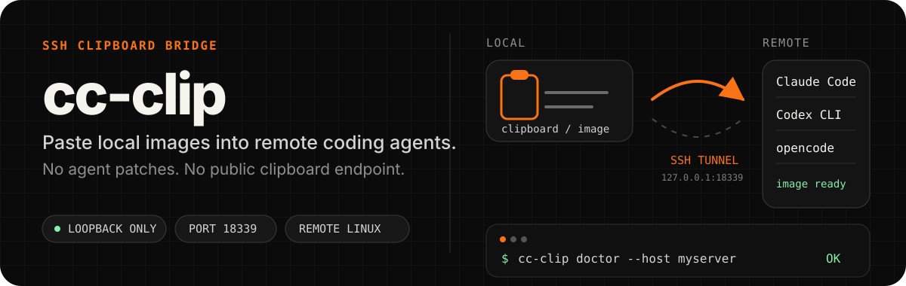
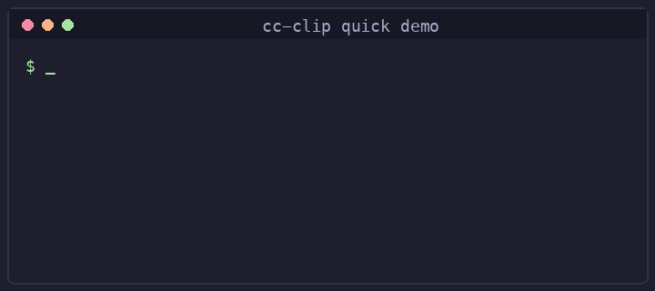

<!-- i18n-source: README.md @ 9055ecbd62edb0fab586ab2ecfffc7963ed013c6 -->

<p align="center">
  <a href="README.md">English</a> ·
  <b>简体中文</b> ·
  <a href="README.ja.md">日本語</a>
</p>

<p align="center">
  
</p>

> 本文是英文原文的简体中文翻译。若内容有差异，以 [English 原文](README.md) 为准。翻译版本可能晚于英文主线更新。

<p align="center">
  <a href="https://github.com/ShunmeiCho/cc-clip/releases"></a>
  <a href="https://github.com/ShunmeiCho/cc-clip/actions/workflows/ci.yml"></a>
  <a href="LICENSE"></a>
</p>

<p align="center">
  <b>通过 SSH 将图片粘贴到远程 Claude Code、Codex CLI、opencode 和 Cursor 会话中——并把文本原样复制回来，不带终端软换行。</b><br>
  可选集成还能把任务完成和授权请求通知发送回桌面。
</p>

<p align="center">
  <a href="#快速开始">快速开始</a> ·
  <a href="#选择目标">选择目标</a> ·
  <a href="#你可以做什么">你可以做什么</a> ·
  <a href="#全部命令">全部命令</a> ·
  <a href="#工作原理">工作原理</a> ·
  <a href="#文档">文档</a>
</p>

<p align="center">
  
  <br>
  <em>安装 → 设置 → 打开 SSH → 粘贴。</em>
</p>

> **从 v0.8.x 升级？** 在 v0.9.0 中，`--codex` 改为仅配置 Codex。如果
> 同一台主机还需要 Claude 集成，请使用 `--all`。参见
> [升级指南](docs/upgrading.md#upgrading-from-v08x-to-v090)。

## 快速开始

这是稳定的 macOS 到 Linux 路径。需要：

- macOS 13 或更高版本；
- 一台 amd64 或 arm64 Linux 远程主机，并安装 `curl`、`bash`，以及 `xclip` 或 `wl-paste`；
- `~/.ssh/config` 中有一个命名的 `Host` 条目。

### 1. 安装

```bash
curl -fsSL https://raw.githubusercontent.com/ShunmeiCho/cc-clip/main/scripts/install.sh | sh
cc-clip --version
```

如果安装程序提示，请先将 `~/.local/bin` 添加到 `PATH`，再继续。

### 2. 设置一台主机

```bash
cc-clip setup myserver
```

默认目标是 Claude Code。设置过程会检查本地依赖、添加仅绑定回环地址的
`RemoteForward`、启动本地守护进程并部署远程 shim。若要配置 Codex、
opencode 或通知，请使用下一节中的目标选项。

### 3. 打开新的 SSH 会话

```bash
ssh myserver
```

启动编程代理，然后照常粘贴。新的 SSH 连接很重要：
它会保持反向隧道打开。

### 4. 验证完整链路

将一张图片复制到 Mac 剪贴板，然后在本地运行：

```bash
cc-clip doctor --host myserver
```

## 选择目标

每次设置选择一个目标选项。不指定目标选项时，cc-clip 会配置 Claude Code。

| 远程工作流 | 设置命令 | 图片粘贴 | 桌面通知 | 额外要求 |
|---|---|:---:|:---:|---|
| Claude Code | `cc-clip setup myserver` | 是 | 是 | `xclip` 或 `wl-paste` |
| 仅 Codex CLI | `cc-clip setup myserver --codex` | 是 | 是 | Xvfb；设置过程可能需要远程 `sudo` |
| 所有集成 | `cc-clip setup myserver --all` | 是 | 是 | Codex 需要 Xvfb |
| opencode | `cc-clip setup myserver --opencode` | 是 | 是 | `xclip` 或 `wl-paste` |
| Antigravity | `cc-clip setup myserver --agy` | 否 | 是 | 仅通知集成 |
| Cursor CLI | `cc-clip setup myserver --cursor` | 是 | 是 | Cursor 所在 shell 中需已设置 `DISPLAY` 或 `WAYLAND_DISPLAY` |

对于 Codex 目标，cc-clip 会尝试使用 `apt` 或 `dnf` 安装 Xvfb。如果
无法使用免密码 `sudo`，它会停止并输出准确的安装命令；
手动运行该命令，然后重新执行设置。

Claude、opencode 和 Cursor 路径使用远程 `xclip` 或 `wl-paste` shim。Codex
直接读取 X11，因此其目标会额外配置 Xvfb 和 `cc-clip x11-bridge`。

Cursor 有一个部署无法代为满足的前提条件：只有当 Cursor 所在的 shell 中设置了
`DISPLAY` 或 `WAYLAND_DISPLAY` 时，它才会读取剪贴板（用 `echo $DISPLAY` 检查）。
请用 `ssh -X myserver` 连接，或导出一个已存在的显示——cc-clip 有意不凭空注入
一个：背后没有 X 服务器的 `DISPLAY` 会让该 shell 中所有其他工具的剪贴板回退
必然失败。此外 Cursor 约 4 秒后就会停止等待剪贴板辅助进程，因此在慢速链路上
传大图时，请在远程 shell rc 中加入 `export CC_CLIP_FETCH_TIMEOUT_MS=3000`。
Cursor 的通知来自合并进 `~/.cursor/hooks.json` 的 stop hook；该文件中你自己的
hook 会被保留。

如果远程的 `cc-clip` 已由包管理器管理，可用 `cc-clip setup myserver
--use-remote-bin` 保留这种归属。设置过程会在你远程**登录 shell** 的 PATH 下
解析 `cc-clip`（因此能找到 `~/.nix-profile/bin`、pipx 和 asdf 安装的版本），
记录其版本与哈希，并照常完成全部集成配置，而不上传替代二进制。

该模式会记入主机的部署状态：之后的 `cc-clip connect` 运行——包括
`cc-clip update` 提示你执行的那条 `connect <host> --force`——无需再带此
标志即可继续使用包管理的二进制。用 `--local-bin` 部署可将主机切回上传
模式。同一次运行中该标志不能与 `--local-bin` 组合。

> opencode 和 Antigravity 的集成生成已有测试覆盖，但尚未在代表性主机上
> 对事件交付进行冒烟测试。请
> [报告测试结果](https://github.com/ShunmeiCho/cc-clip/issues)。
>
> Kimi Code 和 MastraCode 通过 shim 会拦截的 `wl-paste` / `xclip` 调用读取
> 剪贴板，因此使用默认目标即可粘贴图片。这一点已通过对照其源码的静态核对和
> shim 测试验证，尚未用真实 CLI 做端到端验证。
>
> Grok Build（xAI 的 `grok` CLI）和 Codex 一样在进程内直接读取 X11 剪贴板，因此它通过
> Codex 目标粘贴：使用 `--codex`，若还要保留 Claude Code 则用 `--all`。这一点已对照其源码
> 静态核实，尚未做端到端验证。Grok Build 读取剪贴板约 2 秒后就会放弃，因此在慢速链路上
> 传大图时，图片可能来不及送达。

### 其他本地平台

| 本地机器 | 远程主机 | 支持级别 | 推荐路径 |
|---|---|---|---|
| macOS 13+ | Linux | 稳定 | `cc-clip setup HOST` |
| Windows 10/11 | Linux | 实验性 | [`send` / `hotkey` 快速开始](docs/windows-quickstart.md) |
| Linux | Linux | 手动运行守护进程 | 运行 `cc-clip serve`，然后在另一个 shell 中运行 `cc-clip setup HOST` |

Windows 支持仍处于实验阶段。请先使用 [Windows 快速开始](docs/windows-quickstart.md)
中的显式上传并粘贴工作流。另有一个可选的直接 RemoteForward 传输
（自 v0.9.1 起提供），但它不是默认方案。

## 你可以做什么

下面每个功能都说明：它做什么、为什么要用、怎么开启，以及正常工作时你会看到
什么。把 `myserver` 换成你的主机名。

### 把图片粘贴到远程代理

- **作用：**在远程的 Claude Code、opencode、Cursor、Kimi Code 或 MastraCode
  会话中按 `Ctrl+V`，粘贴的是你本地剪贴板里的图片。
- **为什么：**远程代理看不到你 Mac 的剪贴板。没有 cc-clip 时，你得先保存截图，
  用 `scp` 传过去，再手动输入它的路径。
- **怎么用：**运行 `cc-clip setup myserver`（opencode 或 Cursor 加上 `--opencode`
  或 `--cursor`），然后打开一个**新的** `ssh myserver`，照常粘贴。
- **你会看到：**代理像在本地一样附上图片；同时 Mac 会弹出一条 `cc-clip #N` 通知，
  显示图片的尺寸和格式，漏粘或重复粘贴一眼就能看出来。
- **用不到？**文本是双向的：持有远程 token 的进程也能读取你本地剪贴板中的文本。
  守护进程只提供你列出的功能：`cc-clip service install --features image` 只保留图片粘贴、关闭其余功能，
  `--features image,text-write` 则只保留这个方向。详见 [SECURITY.md](SECURITY.md)。

### 把图片粘贴到 Codex CLI

- **作用：**同样的 `Ctrl+V`，用于 Codex 和 Grok Build。
- **为什么：**Codex 和 Grok Build 直接读取 X11 剪贴板，不调用 `xclip`，上面的 shim 够不到它们。
  cc-clip 会在远程运行一个私有的虚拟显示（Xvfb），从那里提供你的图片。
- **怎么用：**运行 `cc-clip setup myserver --codex`（若还要保留 Claude Code，用
  `--all`），然后打开新的 SSH 会话，让 shell 读入显示设置。
- **你会看到：**代理附上图片。如果没有，请看[故障排查](#故障排查)中关于 Codex
  的条目。

### 把远程的文本复制到本地剪贴板

- **作用：**在远程复制的文本会进入你的本地剪贴板。
- **为什么：**用鼠标选中文本时，复制的是终端画出来的内容，长行会被软换行拆断。
  在远程一侧复制，字节保持原样。
- **怎么用：**在远程把任意内容通过管道交给 `cc-clip copy`；或者把 neovim /
  tmux copy-mode 设置为使用 `xclip` 或 `wl-copy` 后直接 yank
  （[各自的配置方法](docs/reverse-copy.md)）：

  ```bash
  git diff | cc-clip copy
  ```

- **你会看到：**文本出现在本地剪贴板，并弹出一条 "Clipboard set by remote" 通知。
  通知里不会包含复制的内容，连续多次 yank 只显示为一条通知。

### 代理需要你时收到桌面通知

- **作用：**远程代理结束一轮回答、或等待工具授权时，Mac 会通知你。
- **为什么：**你可以去别的窗口工作，不必盯着终端。远程的通知通常无法穿过 SSH。
- **怎么用：**不需要额外操作：`setup` / `connect` 会为你选择的每个目标接好通知
  hook（[各 CLI 的细节](docs/notifications.md)）。
- **你会看到：**例如一条 "Tool approval needed" 通知，内容是 Claude Code 自己的
  授权提示。要确认某台主机的通知确实能送达，运行
  `cc-clip doctor --host myserver`，看下面的 `delivery-receipt` 行。

### 检查一切是否正常

- **作用：**`cc-clip doctor --host myserver` 会检查从你的剪贴板到远程代理的每一环，
  每项检查都报告为 `[pass]` 或 `[FAIL]`，并附上原因。
- **为什么：**粘贴可能在多个环节失败（守护进程、SSH 转发、token、shim、PATH），
  每种情况的修法都不同。
- **怎么用：**先在本地复制一张图片，然后在本地机器上运行上面的命令。
- **你会看到：**每项检查一行。先修第一个 `[FAIL]`，后面的通常是它引起的。通知相关的
  行永远不会让检查失败，它们告诉你这台主机上每个 CLI 最近一次送达通知的时间：

  ```text
    delivery-receipt:claude: [pass] last notification accepted 2h13m ago
    delivery-receipt: [pass] never received from: cursor, opencode, agy (fine for any you do not use on this host)
  ```

### 保留你自己的 `xclip` 或 `wl-paste`

- **作用：**对于 `~/.local/bin/xclip`、`wl-paste` 或 `wl-copy` 处不是 cc-clip 写入的
  普通文件，cc-clip 绝不会覆盖。（如果那里是符号链接，链接会被替换，但它指向的程序
  保持不动，并成为 shim 的回退目标。）
- **为什么：**那个文件可能是你自己的包装脚本或构建产物；悄悄丢掉它会让其他工具出问题。
- **怎么用：**如果 `connect` 停下并提示 `... already exists and was not written by
  cc-clip`，你可以自己把文件移开，或者让 cc-clip 把它移到一旁：

  ```bash
  cc-clip connect myserver --adopt-foreign-shim
  ```

- **你会看到：**你的程序被移到 `~/.local/bin/xclip.cc-clip-real`。shim 不处理的调用
  都会交给这个程序；在远程运行 `cc-clip uninstall` 会把它移回原处。

### 让每台主机保持最新

- **作用：**`cc-clip hosts list` 列出这台机器部署过的每台主机，以及它的 cc-clip 版本
  和最近一次连接的时间。
- **为什么：**本地和远程是分别升级的；停留在旧版本的主机会继续使用旧的 shim 和 hook。
- **怎么用：**先在本地升级，再逐台重新部署：

  ```bash
  cc-clip update
  cc-clip connect myserver --force
  ```

- **你会看到：**`cc-clip hosts list` 显示该主机已是新版本。

### 让隧道自行保持连接 (实验性)

- **作用：**`cc-clip tunnel run myserver` 会维护一条到主机的私有 SSH 连接，由它持有粘贴用的
  隧道，并通过守护进程检查隧道状态，断开后按退避策略自动重连。
- **为什么：**平时是哪个 `ssh myserver` 先连上，隧道就归哪个会话。那个会话一关闭，或者在
  不稳定的网络上客户端消失而远程仍占着端口，粘贴就会失效，直到你找出并结束那个会话
  （参见[故障排查指南](docs/troubleshooting.md#stale-sshd-process-blocks-remoteforward)）。
- **怎么用：**在你的本地机器上（运行 `cc-clip serve` 的那台，不是远程主机），每台主机先部署
  一次，然后让它在一个终端里持续运行：

  ```bash
  cc-clip connect myserver --force   # 部署 supervisor 要探测的辅助程序
  cc-clip tunnel run myserver        # 前台运行；按 Ctrl-C 停止
  ```

- **你会看到：**带时间戳的日志，例如 `managed tunnel state: healthy`，每次重连或等待时都会
  打印新的状态行。如果误在远程主机上运行，它会以 `identity-mismatch` 停止并说明原因。它不会
  修改你的 SSH 配置，所以每个 `ssh myserver` 仍会申请同一个端口，包括其他工具保持的后台连接。
  谁先拿到端口就由谁持有，supervisor 会报告 `port-conflict` 并等待。若想在试用期间让
  supervisor 独占端口，请在 `~/.ssh/config` 的 `Host myserver` 下注释掉 `RemoteForward` 那一行，
  试用结束后再恢复。用 `--use-remote-bin` 设置的主机暂不支持；supervisor 运行期间，token 会
  一直保持有效。

### 从主机上移除 cc-clip

- **作用：**撤销 `setup` / `connect` 安装的内容。
- **为什么：**不再在某台主机上使用 cc-clip，或者想从干净的状态重新开始。
- **怎么用：**移除要在两个地方进行，因为 shim 在远程。先做远程这一步：本地那一步会
  删除让远程 shell 找到 `cc-clip` 的 PATH 配置。

  ```bash
  # 1. 在远程主机上：移除 shim，并恢复被收养的程序。
  #    Wayland 主机需要加 --target wl-paste（同时处理 wl-copy）。
  cc-clip uninstall

  # 2. 在本地机器上：移除托管的 Claude hook 和 PATH 标记
  cc-clip uninstall --host myserver
  #    如果用过 Codex，再移除它的显示和桥接器
  cc-clip uninstall --codex --host myserver
  ```

- **你会看到：**远程输出 `Shim removed successfully.`。如果期间有其他进程改动了 shim
  或你的程序，卸载会停下、不删除任何东西，并说明它把什么留在了哪里；等路径稳定后再
  运行一次即可。在 Mac 上，第 2 步还会警告本地没有 shim 可删，这是正常的。

## 工作原理

cc-clip 将传输范围限制在 SSH 连接的本地范围内：

```text
Image paste
  local clipboard
      → cc-clip daemon on 127.0.0.1:18339
      → SSH RemoteForward
      → remote xclip/wl-paste shim or Xvfb bridge
      → remote coding agent

Notifications
  remote hook / notify command / plugin
      → SSH tunnel
      → local cc-clip daemon
      → macOS Notification Center or cmux
```

1. 只有远程端请求时，本地守护进程才会读取剪贴板数据。
2. SSH 在远程回环地址上暴露该守护进程；不会创建公开监听端口。
3. Claude Code 和 opencode 通过透明的剪贴板 shim 访问它。
4. Codex 通过 Xvfb 剪贴板所有者访问它，因为 Codex 会直接读取 X11，
   而不是调用 `xclip`。
5. 无法识别的 `xclip` / `wl-paste` 调用会转交给真正的远程工具。

## 通知

剪贴板数据和代理事件共享 SSH 隧道，但使用独立的
认证材料。`cc-clip connect` 可以接入：

| 来源 | 集成方式 | 事件示例 |
|---|---|---|
| Claude Code | 托管 hook | 停止、授权请求、图片粘贴 |
| Codex CLI | `notify` 命令 | 任务完成 |
| opencode | 生成的 plugin | 会话空闲 |
| Antigravity | 生成的 plugin | 代理停止 |
| Cursor CLI | `~/.cursor/hooks.json` 中的 stop hook | 一轮回答结束 |

有关适配器细节、手动配置、nonce 注册和诊断，请参见
[SSH 通知](docs/notifications.md)。

## 安全模型

| 边界 | 防护措施 |
|---|---|
| 网络 | 守护进程和转发端口仅绑定回环地址 |
| 剪贴板 | 使用 30 天滑动过期时间的 Bearer token |
| 通知 | 每次部署使用独立 nonce |
| 进程列表 | token 和 hook payload 不会放入命令行参数 |
| 回退 | 无关剪贴板调用会转交给真正的远程二进制文件 |

同一台远程主机上的用户共享回环网络。token 文件权限为
`0600`，但 cc-clip 无法防御以你的 Unix 账户身份运行或能够读取
你文件的其他进程。在共享或不受信任的主机上使用 cc-clip 前，
请阅读明确的[威胁模型](SECURITY.md)。

## 全部命令

下面列出 `cc-clip` 的每个命令，按运行它的机器分组。
[命令参考](docs/commands.md)列出了每个选项。

**在本地机器上：设置和维护主机**

| 命令 | 作用及使用时机 |
|---|---|
| `cc-clip setup HOST [target]` | 首次设置一台主机：检查本地依赖、添加 SSH `RemoteForward`、启动守护进程、部署。从这里开始。 |
| `cc-clip connect HOST [target]` | 向已设置好的主机部署（或重新部署）cc-clip。只重新发送有变化的部分。 |
| `cc-clip connect HOST --force` | 忽略主机上报的状态，完整重新部署。在 `cc-clip update` 之后、或主机出问题时使用。 |
| `cc-clip connect HOST --token-only` | 只发送当前 token。守护进程重启后粘贴报 token 错误时使用。 |
| `cc-clip connect HOST --adopt-foreign-shim` | 部署时把不是 cc-clip 写入的 `xclip` / `wl-paste` / `wl-copy` 移到一旁，而不是停下。参见[保留你自己的 `xclip`](#保留你自己的-xclip-或-wl-paste)。 |
| `cc-clip hosts list` | 列出这台机器部署过的每台主机，以及版本、Codex 状态和最近连接时间。升级后用它找出需要重新部署的主机。 |
| `cc-clip hosts forget HOST` | 从上述列表中移除一台主机，不会动远程。 |
| `cc-clip uninstall --host HOST` | 从主机上移除托管的 Claude hook 和 PATH 标记。请先在该主机上运行 `cc-clip uninstall`；参见[从主机上移除 cc-clip](#从主机上移除-cc-clip)。 |
| `cc-clip uninstall --codex --host HOST` | 从主机上移除 Codex 支持：停止桥接器和 Xvfb，删除 Codex 的 `notify` 配置和显示设置。 |
| `cc-clip tunnel run HOST` | **实验性。**由一条私有 SSH 连接持有并维护主机的粘贴隧道，断开后自动重连，而不是依赖先拿到端口的那个 `ssh` 会话。请在本机运行，不要在远程主机上运行。前台运行直到 Ctrl-C；需要先运行一次 `connect HOST --force`。`--reset` 清除已触发的崩溃循环保护。参见[让隧道自行保持连接](#让隧道自行保持连接-实验性)。 |

**在本地机器上：守护进程和本机安装**

| 命令 | 作用及使用时机 |
|---|---|
| `cc-clip serve` | 在前台运行剪贴板守护进程。本地机器是 Linux 时需要它；macOS 和 Windows 用下面的服务。`--rotate-token` 强制生成新 token。 |
| `cc-clip service install` / `uninstall` / `status` | 让守护进程随登录启动（macOS launchd、Windows 登录启动）、移除它，或查看它的状态。`setup` 会替你安装。 |
| `cc-clip status` | 显示守护进程是否在运行、使用哪个端口、token 是否存在。快速的本地检查。 |
| `cc-clip doctor` | 只检查本地一侧。 |
| `cc-clip doctor --host HOST` | 检查到某台主机的完整链路，并显示通知最近一次送达的时间。粘贴失败时第一个要运行的命令。 |
| `cc-clip update` | 在本机安装最新发布版本（macOS / Linux）。`--check` 只报告；`--to vX.Y.Z` 指定版本。之后对每台主机运行 `connect HOST --force`。 |
| `cc-clip version` / `help` | 显示版本号，或内置的命令列表。 |

**在 Windows 上（实验性）**

| 命令 | 作用及使用时机 |
|---|---|
| `cc-clip send [HOST] [FILE]` | 把剪贴板图片或某个文件上传到主机，并输出它的远程路径。加 `--paste` 还会把该路径输入到当前窗口。 |
| `cc-clip hotkey [HOST]` | 运行一个全局热键（默认 `Alt+Shift+V`），一次按键完成 `send --paste`。用 `--enable-autostart`、`--status`、`--stop` 管理它。参见 [Windows 快速开始](docs/windows-quickstart.md)。 |

**在远程主机上**

| 命令 | 作用及使用时机 |
|---|---|
| `some-command \| cc-clip copy` | 把管道传入的文本原样放到你的**本地**剪贴板。超过一行的内容都应该用它，而不是鼠标选择。 |
| `cc-clip uninstall` | 移除这台主机上的剪贴板 shim，并放回用 `--adopt-foreign-shim` 收养的程序。Wayland 主机要加 `--target wl-paste`。 |
| `cc-clip notify --title T --body B` | 向你的本地桌面发送自定义通知，例如在长脚本结束时。除非加上 `--trusted`，标题会以 `[unverified]` 开头。 |
| `cc-clip paste` | 把本地剪贴板中的图片保存为远程上的文件，并输出其路径。适用于接收图片路径而不是粘贴的脚本和工具。 |

**cc-clip 内部使用**（你不需要手动运行）

| 命令 | 用途 |
|---|---|
| `cc-clip install` | 安装 shim；`connect` 会在远程运行它。 |
| `cc-clip plugin run NAME` | 各代理调用的通知 hook（`claude-notify`、`codex-notify`、`opencode-notify`、`agy-notify`、`cursor-notify`）。 |
| `cc-clip x11-bridge` | 通过 Xvfb 向 Codex 提供剪贴板；由 `connect --codex` 启动。 |
| `cc-clip tunnel probe-identity` | 在远程回应托管隧道的身份检查；由 `tunnel run` 调用。 |

### 配置

| 设置 | 默认值 | 环境变量 |
|---|---:|---|
| 隧道端口 | `18339` | `CC_CLIP_PORT` |
| token 有效期 | `30d` | `CC_CLIP_TOKEN_TTL` |
| 调试日志 | 关闭 | `CC_CLIP_DEBUG=1` |

## 故障排查

先运行内置诊断：

```bash
cc-clip doctor --host myserver
```

最常见的三个修复方法是：

- **隧道不可用：**保持一个新的 `ssh myserver` 会话打开。
  `RemoteForward` 仅在 SSH 连接持有它时存在。
- **守护进程重启后 token 被拒绝：**运行
  `cc-clip connect myserver --token-only`。
- **Codex 没有剪贴板：**打开新的 SSH 会话，以加载注入的 `DISPLAY`；
  如果缺少 Xvfb 或 x11-bridge，运行
  `cc-clip connect myserver --codex --force`（或 `--all --force`）。

如果新的 SSH 标签页报告 `remote port forwarding failed for listen port 18339`，
说明另一个活动或残留的 SSH 会话已经占用固定远程端口。使用仍可工作的会话、
关闭旧会话，或按照[故障排查指南](docs/troubleshooting.md)中的端口清理步骤操作。

## 不适合使用 cc-clip 的场景

如果有更简单的方案，请优先使用：

- 如果整个工作流已经在编辑器内，使用编辑器内置的远程剪贴板；
- 仅同步文本剪贴板时，使用 OSC 52；
- 很少传输图片，且不值得为保留粘贴行为运行守护进程和 SSH 转发时，使用 `scp`；
- 需要广泛的双向剪贴板同步，而不是针对代理的窄工作流时，使用通用剪贴板桥接器；
- 如果远程本地用户不能访问你的用户级回环隧道，请避免在不受信任的共享主机上使用 cc-clip。

## 文档

| 指南 | 内容 |
|---|---|
| [Windows 快速开始](docs/windows-quickstart.md) | Windows 上传、粘贴和热键工作流 |
| [升级](docs/upgrading.md) | 破坏性变更和特定版本迁移 |
| [命令](docs/commands.md) | 常用命令、选项和环境变量 |
| [通知](docs/notifications.md) | hook 和 plugin 集成 |
| [故障排查](docs/troubleshooting.md) | 按症状诊断 |
| [安全](SECURITY.md) | 威胁模型和信任边界 |

## 贡献

欢迎提交 bug 报告和范围明确的 pull request。对于较大的功能，请先创建
[issue](https://github.com/ShunmeiCho/cc-clip/issues)，以便讨论实现方案。

从源代码构建需要使用 `go.mod` 中声明的 Go 版本：

```bash
git clone https://github.com/ShunmeiCho/cc-clip.git
cd cc-clip
make build
make test
```

提交消息请遵循 [Conventional Commits](https://www.conventionalcommits.org/)
规范（`feat:`、`fix:`、`docs:` 等）。

## 许可证

[MIT](LICENSE)
